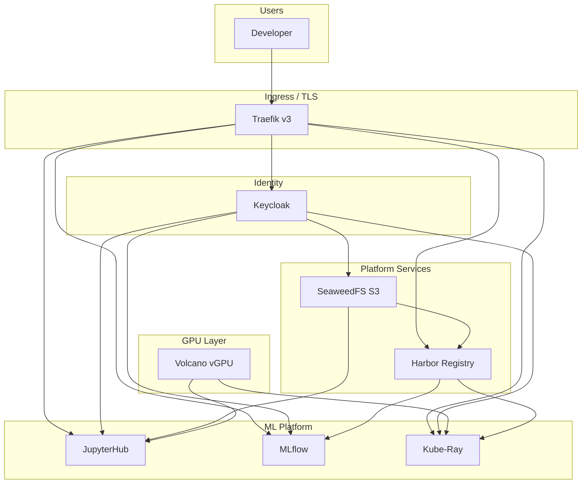
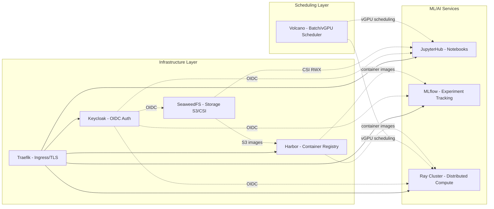

# Architecture Overview

The platform is a GPU-accelerated ML/AI environment running on a 4-node K3s Kubernetes cluster at FMFI DAI. All services share a single domain (`*.c.dai.fmph.uniba.sk`) with TLS via Let's Encrypt.

## High-Level Architecture

## Service Dependency Graph

## Key Characteristics

- **Single cluster**: 6 nodes, 1 control plane, 5 workers with specialized roles (GPU ×3, service, storage)
- **Central auth**: Keycloak with `compute` realm, 6 OIDC clients, GitHub as external IdP
- **GPU sharing**: 3 schedulable GPUs (2× RTX 5090, 1× TITAN V), each split into up to 25 virtual GPUs via Volcano/Hami; the legacy TITAN Xp is masked (CUDA-arch conflict, see [gpu-cuda-compatibility.md](gpu-cuda-compatibility.md))
- **Distributed storage**: SeaweedFS provides both S3 API and CSI (ReadWriteMany) mounts
- **Private registry**: Harbor stores all custom and mirrored images, backed by SeaweedFS S3
