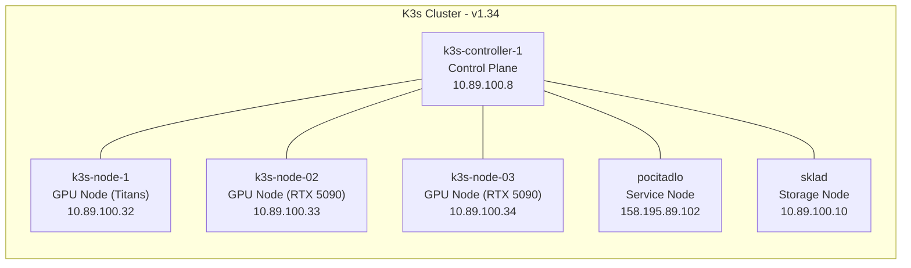
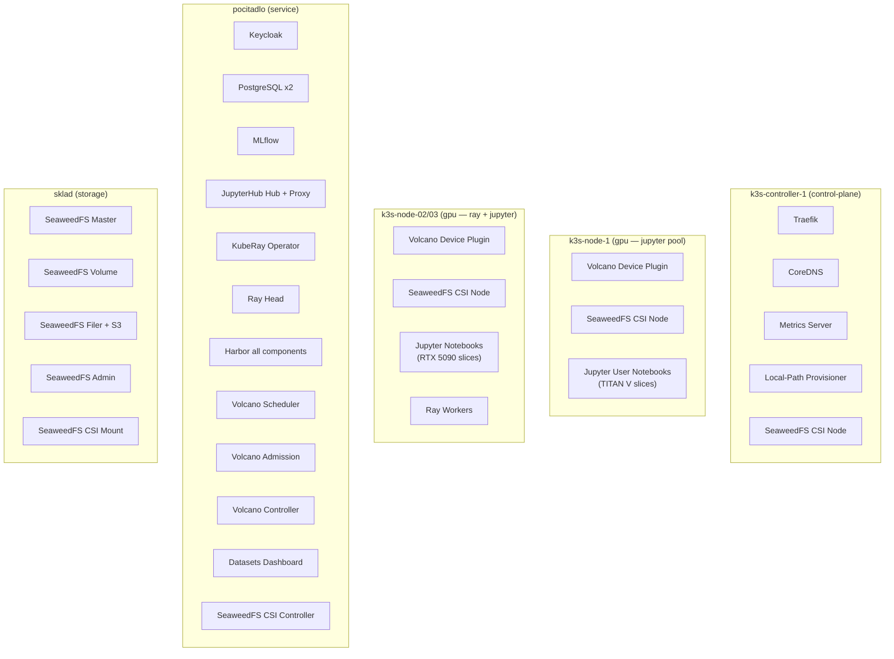

# Cluster Nodes

The K3s cluster consists of 6 nodes, each with a dedicated role. The cluster uses SQLite datastore (single server mode) with custom CIDRs.

## Node Architecture



## Node Details

| Node | Role | IP | OS | GPU | Notes |
|------|------|----|----|-----|-------|
| k3s-controller-1 | `control-plane` | 10.89.100.8 | Ubuntu 24.04.3 | — | k3s data on root LV |
| k3s-node-1 | `gpu` | 10.89.100.32 | Ubuntu 24.04.3 | TITAN V (schedulable) + TITAN Xp (masked) | jupyter pool only |
| k3s-node-02 | `gpu` | 10.89.100.33 | Ubuntu 24.04.3 | RTX 5090 32G | k3s data on 7.3T `k3s-data` LV |
| k3s-node-03 | `gpu` | 10.89.100.34 | Ubuntu 24.04.3 | RTX 5090 32G | k3s data on 7.3T `k3s-data` LV |
| pocitadlo | `service` | 158.195.89.102 | Ubuntu 24.04.4 | — | holds all local-path PVs |
| sklad | `storage` | 10.89.100.10 | Ubuntu 24.04.4 | — | SeaweedFS; 62G root — never pull GPU images |

## What Runs Where



## Node Labels

| Label | Applied To | Used By |
|-------|-----------|---------|
| `node-role.kubernetes.io/control-plane` | k3s-controller-1 | Traefik placement |
| `node-role.kubernetes.io/gpu` | k3s-node-1, -02, -03 | GPU workloads, Volcano device plugin |
| `node-role.kubernetes.io/service` | pocitadlo | Harbor, platform services |
| `node-role.kubernetes.io/storage` | sklad | SeaweedFS components |
| `gpu-node: "true"` | k3s-node-1, -02, -03 | Volcano device plugin DaemonSet, jupyter GPU pool |
| `accelerator: nvidia-gpu` | k3s-node-02, -03 only | ray workers, future 5090-only workloads |
| `sw-backend: "true"` | sklad | SeaweedFS master/filer |
| `sw-volume: "true"` | sklad | SeaweedFS volume server |

## Ansible Inventory

The cluster is provisioned via Ansible (`ansible-k3s-setup/fmfi-hosts.yml`):

```yaml
controller:
  hosts:
    master:
      ansible_host: fmfi-k3s-ctl
      ansible_user: ubuntu
node:
  hosts:
    worker1:                      # k3s-node-1, Titans
      ansible_host: fmfi-k3s-n1
      ansible_user: ubuntu
    k3s-node-2:                   # pocitadlo, service node
      ansible_host: pocitadlo
      ansible_user: filip
    sklad:
      ansible_host: sklad
      ansible_user: filip
      k3s_node_ip: 10.89.100.10
    worker2:                      # k3s-node-02, RTX 5090
      ansible_host: fmfi-k3s-n2
      ansible_user: spravovatel
    worker3:                      # k3s-node-03, RTX 5090
      ansible_host: fmfi-k3s-n3
      ansible_user: spravovatel
```
